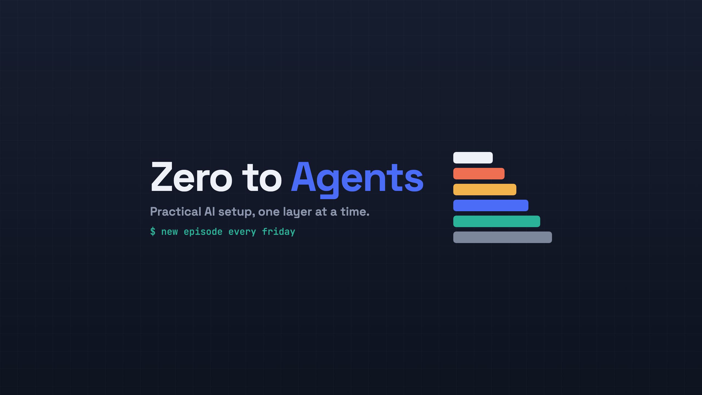

# EP04 · Ollama: your first local model in five minutes

**Zero to Agents** · Level 1 · Mac · (video link added when the episode goes live)

> Run AI models locally on your Mac with Ollama: install it, pull Qwen 3.5, chat in the terminal, check what fits your RAM, and call the local API. Free and private.

## What you'll have at the end

Ollama installed and running as a background service, two local models pulled and tested, and the local API answering on your Mac. No account, no API key, no per-token cost.

## Before you start

- Finish [EP02](../ep02-base-layer/) first.
- A Mac you can install software on (you'll need your password).

**Tested with:** macOS 26.6.2 (Apple silicon, 16 GB VM), homebrew 7.0.16, ollama 0.40.18, models qwen3.5:2b (3.1 GB), qwen3.5:4b (4.0 GB)

## Steps

### 1. Install

Install Ollama with Homebrew. It needs a few libraries, so Homebrew asks you to confirm. Type y. Then start it as a background service, so it's always ready, even after a restart. Ollama listens on port 11434. A quick curl confirms it's running.

```zsh
brew install ollama
brew services start ollama
curl localhost:11434; echo
```

### 2. First model

Now download a model. We'll start with Qwen 3.5, the two billion parameter version, about three gigabytes. The download takes a few minutes, so we'll skip ahead. Then ask it a question. These models think before they answer by default. For quick answers, add think equals false. That answer came from your Mac, not the internet.

```zsh
ollama pull qwen3.5:2b
ollama run qwen3.5:2b --think=false "In one sentence, what is an API key?"
```

### 3. How much ram

Here's the mistake that makes people think local AI is slow. They download a model that's too big for their memory. The model has to fit in RAM, with room to spare. Check how much you have, and how big each model is. A rough guide: with eight gigabytes, stay at four billion parameters or less. Sixteen gigabytes handles around nine billion. Thirty-two and up opens the bigger models.

```zsh
sysctl -n hw.memsize | awk '{print $1/1073741824 " GB of RAM"}'
ollama list
```

### 4. Bigger model

Let's try a bigger one, the four billion version. It fits easily here. Add dash dash verbose to see the speed in tokens per second. Then ollama ps shows what's loaded, how much memory it uses, and that it's running on the GPU.

```zsh
ollama pull qwen3.5:4b
ollama run qwen3.5:4b --think=false --verbose "Write a haiku about the terminal."
ollama ps
```

### 5. Local api

Ollama also gives you a local API, which is how other apps and tools will talk to your models later in this series. One request, and the answer comes back from localhost. Nothing leaves your machine. Once a model is downloaded, this all works offline too. Turn off Wi-Fi and try it.

```zsh
curl -s localhost:11434/api/generate -d '{"model":"qwen3.5:2b","prompt":"Say hi in five words","stream":false,"think":false}' | python3 -c "import sys,json; print(json.load(sys.stdin)['response'])"
```

### 6. Housekeeping

Models take real disk space. List them, check the folder size, and remove the ones you don't need.

```zsh
ollama list
du -sh ~/.ollama/models
ollama rm qwen3.5:4b
```

## The mistake almost everyone makes

**The mistake that makes local AI painfully slow**

Here's the mistake that makes people think local AI is slow. They download a model that's too big for their memory. The model has to fit in RAM, with room to spare. Check how much you have, and how big each model is. A rough guide: with eight gigabytes, stay at four billion parameters or less. Sixteen gigabytes handles around nine billion. Thirty-two and up opens the bigger models.

## Troubleshooting

- `Error: could not connect to ollama app`: the server isn't running. Run `brew services start ollama`, or open the Ollama app.
- Answers are very slow: the model is probably too big for your RAM. Try a smaller one (2B or 4B) and check `ollama ps`.
- The model spends a long time 'thinking': add `--think=false` for quick answers.
- Disk filling up: models live in `~/.ollama/models`. Remove ones you don't use with `ollama rm <name>`.

## Next

Continue with [EP05]().

---

Made by [Zero to Agents](https://www.youtube.com/@zerotoagents). Narrated by an AI voice and produced with AI agents; every command was run for real on a clean machine. Found a step that no longer works? Open an issue.
